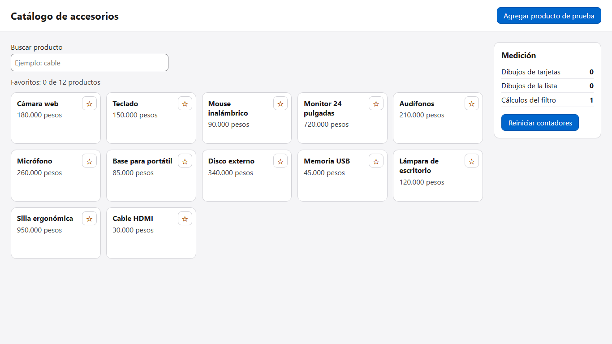

# Práctica 1.4: diagnóstico y optimización de dibujos en una SPA

| Campo | Valor |
|---|---|
| Duración | 24 minutos |
| Complejidad | Media |
| Nivel de Bloom | Aplicar |

## De qué trata

Vas a medir una SPA (aplicación de una sola página) que trabaja de más y a mejorarla con tres herramientas de Vue: `computed`, props (los datos que un componente padre le pasa a un hijo) y `shallowRef`. Es un catálogo de 12 productos con un panel que cuenta cuántas veces Vue vuelve a dibujar cada parte. Al marcar un producto como favorito, hoy se redibujan las 12 tarjetas; al terminar, solo se redibuja 1. No se trata de que "se sienta" más rápida: vas a ver el número antes y después.


## Objetivos

Al terminar podrás:

- Identificar, con números, qué cambio provoca dibujos innecesarios.
- Reemplazar un cálculo repetido en la plantilla por un `computed`.
- Pasar a un componente solo lo que necesita por props, para que no se redibuje cuando cambia lo demás.
- Usar `shallowRef` en una lista grande y agregar elementos sin que la pantalla se quede quieta.

## Antes de empezar

- **Node.js 20 o superior** (el programa que ejecuta JavaScript fuera del navegador). Compruébalo con `node -v`.
- Google Chrome y un editor de código, como Visual Studio Code. Si VS Code ofrece instalar la extensión **Vue (Official)**, acéptala: colorea el código de los archivos `.vue`.
- El repositorio del curso descargado en tu equipo.
- Opcional: la extensión **Vue Devtools** en Chrome, para ver el árbol de componentes.

## Preparación (4 minutos)

1. Abre una terminal **en la carpeta donde descargaste el repositorio** y entra a la carpeta del laboratorio. El comando es igual en Windows, macOS y Linux:

   ```bash
   cd Capitulo01/laboratorio
   ```

2. Instala las dependencias (las librerías que el proyecto necesita). Tarda uno o dos minutos la primera vez:

   ```bash
   npm install
   ```

3. Arranca el servidor de desarrollo:

   ```bash
   npm run dev
   ```

4. Abre `http://127.0.0.1:5173` en Chrome.

**Qué debes ver:** el catálogo con 12 tarjetas y, a la derecha, el panel **Medición** con sus tres contadores.



Los archivos que vas a tocar están en `src/`: `App.vue` y los dos de `src/components/`: `ListaProductos.vue` y `TarjetaProducto.vue`. El panel de medición (`PanelMedicion.vue` y `medicion.js`) ya está hecho y no se modifica.

## Paso 1. Medir el problema (4 minutos)

**Qué vas a hacer y por qué:** antes de optimizar hay que medir. Si no tienes el número de antes, no puedes demostrar la mejora.

**Primero, predice:** si marcas como favorito un solo producto, ¿cuántas tarjetas crees que se vuelven a dibujar? Anótalo.

1. Pulsa **Reiniciar contadores**.
2. Pulsa la estrella ☆ de **Teclado**.
3. Anota los tres números del panel en la columna "Antes" de esta tabla:

| Medición tras marcar un favorito | Antes | Después |
|---|---|---|
| Dibujos de tarjetas | | |
| Dibujos de la lista | | |
| Cálculos del filtro | | |

**Qué debes ver:** Dibujos de tarjetas **12**, Dibujos de la lista **1**, Cálculos del filtro **1**.


**Por qué pasa:** abre `src/components/TarjetaProducto.vue`. Cada tarjeta recibe con `inject` (la función que recibe lo que `App.vue` comparte con `provide`) la lista **completa** de favoritos y la recorre con `includes`. Vue anota que todas las tarjetas leyeron esa lista; cuando cambia, las redibuja a todas, aunque solo una cambió de estrella.

## Paso 2. Guardar el filtro con computed (4 minutos)

**Qué vas a hacer y por qué:** la lista llama a la función `filtrar()` en la plantilla, así que la vuelve a ejecutar cada vez que se dibuja, aunque la búsqueda no haya cambiado. Un `computed` guarda el resultado y solo lo recalcula cuando cambia algo que usa.

**Dónde:** `src/components/ListaProductos.vue`.

1. En la línea del `import`, agrega `computed`:

   ```js
   import { inject, computed, onUpdated } from 'vue'   // computed guarda un resultado y lo recalcula solo si cambia lo que usa
   ```

2. Cambia la función por un `computed`. Solo cambian la primera y la última línea:

   ```js
   const filtrados = computed(() => {                   // antes: function filtrar() {
     contar('filtro')                                   // cuenta cada vez que se calcula el filtro
     const texto = consulta.value.trim().toLowerCase()  // trim quita espacios; toLowerCase pasa a minúsculas
     if (!texto) return productos.value                 // sin texto: todos los productos
     return productos.value.filter((p) => p.nombre.toLowerCase().includes(texto))
   })                                                   // antes: }
   ```

3. En la plantilla, reemplaza el comentario y la línea del `<li>` por estas dos. `filtrados` va sin paréntesis, porque un `computed` se lee como un dato:

   ```html
   <!-- filtrados es un computed: si la consulta no cambió, Vue reutiliza el resultado guardado -->
   <li v-for="producto in filtrados" :key="producto.id">
   ```

4. Guarda. La página se actualiza sola. Pulsa **Reiniciar contadores** y marca otra estrella.

**Qué debes ver:** Cálculos del filtro **0**. Las tarjetas siguen en **12**: eso se arregla en el paso 3.

## Paso 3. Darle a cada tarjeta solo lo que necesita (6 minutos)

**Qué vas a hacer y por qué:** si la tarjeta recibe por prop un simple `true` o `false` ("¿soy favorito?"), Vue solo la redibuja cuando ese valor cambia. Ya no lee la lista completa, así que las demás tarjetas se quedan quietas.

**Dónde:** primero `src/components/TarjetaProducto.vue` y luego `src/components/ListaProductos.vue`.

1. En `TarjetaProducto.vue`, reemplaza todo el bloque `<script setup>` por este:

   ```html
   <script setup>
   import { onUpdated } from 'vue'                      // función que avisa después de cada redibujo
   import { contar } from '../medicion.js'              // contadores del panel

   const props = defineProps({                         // declara los datos que la tarjeta recibe de la lista
     producto: Object,                                  // el producto que se muestra
     favorito: Boolean                                  // true si este producto está marcado
   })
   const emit = defineEmits(['alternar'])               // aviso que la tarjeta le manda a la lista

   onUpdated(() => contar('tarjetas'))                  // cuenta cada vez que esta tarjeta se redibuja
   </script>
   ```

2. En la plantilla de la misma tarjeta, reemplaza el `<button>` por este. Cambia `esFavorito()` por `favorito` y el clic ahora le avisa a la lista:

   ```html
   <button
     type="button"
     class="estrella"
     :aria-pressed="favorito"
     :aria-label="(favorito ? 'Quitar de favoritos: ' : 'Marcar como favorito: ') + producto.nombre"
     @click="emit('alternar', producto.id)"
   >{{ favorito ? '★' : '☆' }}</button>
   ```

   `aria-pressed` y `aria-label` le dicen al lector de pantalla si la estrella está marcada y de qué producto es.

3. En `ListaProductos.vue`, reemplaza la línea `const { productos, consulta, favoritos } = inject('catalogo')` por esta, que toma también `alternarFavorito`:

   ```js
   const { productos, consulta, favoritos, alternarFavorito } = inject('catalogo')
   ```

4. En la plantilla de la lista, reemplaza `<TarjetaProducto :producto="producto" />` por este bloque, que le pasa a cada tarjeta su dato y escucha su aviso:

   ```html
   <TarjetaProducto
     :producto="producto"
     :favorito="favoritos.includes(producto.id)"
     @alternar="alternarFavorito"
   />
   ```

   `:favorito` le entrega a cada tarjeta `true` o `false`; `@alternar` escucha el aviso de la tarjeta y llama a `alternarFavorito` con el id del producto.

5. Guarda, pulsa **Reiniciar contadores** y marca una estrella.

**Qué debes ver:** Dibujos de tarjetas **1**. ¿Se parece a lo que predijiste en el paso 1?


## Paso 4. shallowRef para la lista grande (4 minutos)

**Qué vas a hacer y por qué:** `ref` vigila cada producto por dentro. Con 12 productos no se nota; con miles, cuesta tiempo y memoria. `shallowRef` vigila solo que la lista completa cambie, que es lo que pasa cuando llega del servidor.

**Dónde:** `src/App.vue`.

1. Reemplaza completas la línea del `import` y la línea de `const productos`. El comentario también cambia, porque ahora Vue ya no vigila cada producto por dentro:

   ```js
   import { ref, shallowRef, provide } from 'vue'       // shallowRef vigila solo el cambio de la lista entera
   const productos = shallowRef([...productosIniciales]) // antes: ref([...productosIniciales])
   ```

2. **Predice:** guarda y pulsa **Agregar producto de prueba**. ¿Aparece la tarjeta nueva?

3. No aparece: `push` agrega el producto dentro de la misma lista, y `shallowRef` no mira por dentro. En `agregarProducto`, reemplaza la línea `productos.value.push(nuevo)` por esta, que crea una lista nueva:

   ```js
   productos.value = [...productos.value, nuevo]        // los tres puntos copian los anteriores y se suma el nuevo
   ```

4. Guarda y vuelve a pulsar **Agregar producto de prueba**.

**Qué debes ver:** la tarjeta "Producto nuevo 13" al final y el resumen "Favoritos: 0 de 13 productos".

Cada vez que guardas `App.vue`, Vite vuelve a crear el catálogo: las estrellas que habías marcado se desmarcan y la lista vuelve a los 12 productos. Es normal. Por eso `App.vue` copia la lista de `datos.js` con `[...productosIniciales]`: así el producto que agregó `push` en la predicción no queda guardado en el archivo de datos y no aparece repetido.


## Paso 5. Cerrar la medición (2 minutos)

1. Completa la columna "Después" de la tabla del paso 1.
2. Compara con tu predicción: ¿cuál de los tres cambios redujo más trabajo?

| Medición tras marcar un favorito | Antes | Después |
|---|---|---|
| Dibujos de tarjetas | 12 | 1 |
| Dibujos de la lista | 1 | 1 |
| Cálculos del filtro | 1 | 0 |

La lista se sigue dibujando una vez porque muestra el resumen "Favoritos: N de 12 productos", que sí cambió. Ese dibujo es necesario.

## Resultado esperado

- Componentes que se redibujan de más, identificados con números.
- `shallowRef` aplicado a la lista de productos.
- Filtro con `computed`, sin cálculos repetidos.
- Dibujos de las tarjetas: de 12 a 1.

Si te quedaste atascado, compara tus archivos con los de `Capitulo01/laboratorio-solucion`.

## Problemas frecuentes

| Lo que ves | Por qué pasa | Cómo se arregla |
|---|---|---|
| `npm error enoent ... package.json` | La terminal no está en `Capitulo01/laboratorio` | Entra a esa carpeta con `cd` y repite `npm install` |
| `Port 5173 is already in use` | Otro servidor quedó abierto | Ciérralo con `Ctrl + C` en su terminal, o cierra esa terminal |
| La página queda en blanco tras guardar | Hay un error de sintaxis en el archivo | Abre la consola de Chrome (`F12`) y la terminal: indican el archivo y la línea |
| Las tarjetas siguen en 12 tras el paso 3 | La plantilla todavía usa `esFavorito()` o la lista no pasa `:favorito` | Revisa los pasos 3.2 y 3.4 |
| El producto nuevo no aparece | Falta el paso 4.3: con `shallowRef` hay que asignar una lista nueva | Cambia `push` por `productos.value = [...productos.value, nuevo]` |
| `npm warn install-scripts` al instalar | npm avisa que bloqueó un script de una librería | Es solo un aviso; el laboratorio funciona igual |

## Limpieza

En la terminal del servidor, pulsa `Ctrl + C` para detenerlo.

## Ejercicios de reserva

Para quien termina antes, en `Capitulo01/ejercicios-resueltos`. Cada uno se abre igual: `cd` a su carpeta, `npm install` y `npm run dev`.

| Nivel | Carpeta | Reto |
|---|---|---|
| Básico | `ejercicio-1` | Comprobar que cambiar un dato que la plantilla no lee no redibuja nada |
| Medio | `ejercicio-2` | Encontrar y arreglar una fuga de reactividad al desestructurar |
| Avanzado | `ejercicio-3` | Medir `computed`, `shallowRef` y `v-memo` sobre 5.000 objetos |

Reto extra del catálogo: busca "camara" sin tilde y no aparece "Cámara web". Pista: `texto.normalize('NFD')` separa las tildes de las letras.

## Recursos

- [Reactividad en profundidad](https://vuejs.org/guide/extras/reactivity-in-depth): cómo Vue vigila datos y actualiza la pantalla.
- [Propiedades computadas](https://vuejs.org/guide/essentials/computed): valores calculados que se guardan y recalculan solos.
- [Rendimiento](https://vuejs.org/guide/best-practices/performance): técnicas oficiales, incluidas `shallowRef` y props estables.
